# Awesome AI Cinematography & Video Prompting 🎬✨

<p align="center">
  
</p>

<p align="center">
  <a href="https://github.com/ishandutta2007/Awesome-Awesome-Awesome"></a><a href="https://discord.gg/jc4xtF58Ve"></a>
  <a href="https://github.com/ishandutta2007/Awesome-AI-Cinematography-Video-Prompting/stargazers"></a>
  <a href="https://github.com/ishandutta2007/Awesome-AI-Cinematography-Video-Prompting/network/members"></a>
  <a href="https://github.com/ishandutta2007/Awesome-AI-Cinematography-Video-Prompting/blob/main/LICENSE"></a>
  <a href="https://github.com/ishandutta2007"></a>
</p>

---

## 🌟 Overview & Mission

Welcome to the definitive **Awesome AI Cinematography & Video Prompting** knowledge hub! 🎥🚀 

Generative AI has fundamentally shifted from producing chaotic, uncontrolled clips to providing **director-grade cinematic control**. Whether you are an AI filmmaker, cinematographer, VFX artist, game developer, or creative technologist building sovereign studio pipelines, this repository tracks state-of-the-art **SaaS platforms**, **open-source video foundation models**, and **camera-trajectory control frameworks**.

Key capabilities featured in this ecosystem:
- 📹 **6-DoF Camera Choreography**: Precise pan, tilt, zoom, dolly, truck, crane, roll, and orbital camera paths.
- 💡 **Cinematic Lighting & Optics**: 3-point lighting setups, anamorphic aspect ratios, lens focal lengths (24mm, 35mm, 50mm, 85mm), and shallow depth-of-field control.
- 🎭 **Temporal & Character Consistency**: Cross-shot character blocking, facial reenactment, and multi-scene storyboard fidelity.
- ⚡ **Local Sovereign Inference**: Open-weight Diffusion Transformers (DiTs) running locally in ComfyUI, Diffusers, and WebUI pipelines.

---

## 📑 Table of Contents

- [🌟 Overview & Mission](#-overview--mission)
- [📊 Sector Overview & Market Dynamics](#-sector-overview--market-dynamics)
- [🏢 SaaS & Hosted Cinematic Platforms](#-saas--hosted-cinematic-platforms)
- [💻 Open-Source GitHub Projects](#-open-source-github-projects)
- [📐 AI Cinematography Prompting Guide & Presets](#-ai-cinematography-prompting-guide--presets)
- [📈 Star History](#-star-history)
- [💖 Support & Sponsorship](#-support--sponsorship)
- [🤝 How to Contribute](#-how-to-contribute)
- [📜 Disclaimer](#-disclaimer)

---

## 📊 Sector Overview & Market Dynamics

> [!NOTE]
> **Market Size & Valuation:** The global AI video generation and cinematic synthesis market is valued between **$788M and $5.5B** and is projected to expand to **$3.3B to $47B+** over the next decade at a compound annual growth rate (**CAGR of ~18.8% to 31.4%**).  
> **Market Structure:** The sector is **highly fragmented** rather than a winner-take-all monopoly; frontier hyperscalers (e.g., Google, OpenAI, Tencent, Alibaba) compete alongside hyper-focused specialized studio startups (Runway, Luma AI, Kling AI, Pika) and a vibrant open-source ecosystem (Wan2.1, HunyuanVideo, LTX-Video, ControlNet) catering to sovereign film production.

---

## 🏢 SaaS & Hosted Cinematic Platforms

The following table details leading hosted generative filmmaking suites, sorted in descending order by company valuation/revenue size.

| SaaS Product | Company Scale / Valuation / Revenue | Pricing (Starting Tier) | Free Tier / Trial Limit | Key Cinematic Features |
| :--- | :--- | :--- | :--- | :--- |
| **[OpenAI (Sora)](https://sora.com)** | **~$852B - $1.4T valuation** (ARR >$20B) | **$0.10/sec** (Sora 2 720p API); Pro tiers at **$0.30 - $0.70/sec** | Capped free trial credits & rate-limited developer testing tier | High-fidelity lens depth-of-field, complex 3D world physics, multi-shot cinematic continuity |
| **[Canva / Leonardo.Ai (Motion)](https://leonardo.ai)** | **~$42B valuation** (Canva; Leonardo acquired Jul 2024; ARR >$3B) | **$12.00/mo** (Essential plan, 8,500 monthly tokens) | **150 Fast Tokens per day** (daily recurring refresh, non-expiring daily pool) | Motion intensity control, storyboard concept frame-to-video animation, camera pan/zoom presets |
| **[Kling AI (Kuaishou)](https://klingai.com)** | **~$11.5B - $14.2B market cap** (Kuaishou; Kling unit ~$20B valuation buzz) | **$6.99 first month** (renews **$8.80/mo**, 660 monthly credits) | **66 daily credits** (daily recurring refresh; watermarked, strictly non-commercial) | 1080p cinematic sequences, master camera movement presets (pan, tilt, zoom, roll), high dynamic range |
| **[Runway (Gen-3 Alpha / Gen-4)](https://runwayml.com)** | **~$5.3B valuation** (Series E; ARR >$200M) | **$15.00/mo** (Standard; or **$12.00/mo** billed annually, 625 credits/mo) | **125 one-time credits** (non-renewing, lifetime free tier with Runway watermark) | Directors Mode (pan, tilt, zoom, roll speed sliders), Motion Brush, Act-One performance capture, multi-shot |
| **[Luma Dream Machine](https://lumalabs.ai)** | **~$4.0B valuation** (Series C; ARR ~$50M+) | **$9.99/mo** (Lite, ~3,200 credits/mo) or **$29.99/mo** (Plus, 10,000 credits/mo) | **30 free generations / ~1,000 monthly credits** (watermarked, strictly non-commercial) | Natural-language camera choreography, start/end keyframe interpolation, Ray-2 photoreal camera motion |
| **[MiniMax Hailuo AI (Director Mode)](https://hailuoai.video)** | **~$1.5B - $2.5B market cap** (SEHK: 00100 IPO; ARR >$800M) | **$9.99/mo** (Standard plan) or **$0.05 - $0.13/sec** via developer API | **Daily free login credits (~3-5 free video clips daily)** (watermarked, standard speed) | Director Mode lens movements, physics-informed visual dynamics, cinematic prompt adherence |
| **[Pika Labs (Pika Art)](https://pika.art)** | **~$470M - $700M valuation** (Series B, $135M raised) | **$10.00/mo** (Starter; or **$8.00/mo** billed annually, ~700-900 credits/mo) | **150-250 initial signup credits** (free tier with watermark; daily login bonus top-ups) | Granular pan/tilt/zoom/rotate sliders, Pikaffects, Modify Region camera inpainting, sound effects |
| **[Viggle AI](https://viggle.ai)** | **~$100M - $250M valuation** (Series A, a16z led) | **$9.99/mo** (Pro; or **$7.99/mo** billed annually, 80 credits/mo) | **Daily free credits (~10 free credits/day)** (watermarked, 1 concurrent job, 7-day storage) | JST-1 3D video foundation model, controllable character blocking, physics choreography from video references |
| **[Haiper](https://haiper.ai)** | **~$50M - $100M valuation** ($19.2M seed funding) | **$9.99/mo** (Explore tier) or **$24.00/mo** (Pro commercial tier) | **10 free video generations per day** (daily recurring refresh; non-commercial license) | Controllable camera templates, motion brush repainting, cinematic prompt-to-video synthesis |
| **[Kaiber](https://kaiber.ai)** | **~$30M - $50M valuation** ($10M seed funding, 5M+ users) | **$10.00/mo** (Starter, 500 credits/mo) or **$29.00/mo** (Creator, 1,500 credits/mo) | **5-day trial for $5.00** (grants 500 credits to test all features; auto-renews unless canceled) | Audio-reactive Beat Sync, camera choreography, frame-by-frame style evolution, Superstudio canvas |
| **[DomoAI](https://domoai.app)** | **~$15M - $30M valuation** (Bootstrapped / self-serve ARR) | **$9.99/mo** (Basic, 500 credits/mo; or **$6.99/mo** billed annually) | **15 one-time free trial credits** upon account registration (non-refilling) | Video-to-video cinematic style transfer, anime/3D camera restyling, Relax Mode unmetered generation |

---

## 💻 Open-Source GitHub Projects

The following list contains top open-weight video foundation models, camera-trajectory controllers, prompt engineering skills, and cinematic conditioning toolkits. **Sorted in descending order by GitHub Stars_Counts.**

1. **[Real-ESRGAN](https://github.com/xinntao/Real-ESRGAN)** [](https://github.com/xinntao/Real-ESRGAN/stargazers) 🌟  
   *AI Cinema Restoration & 4K Super-Resolution Engine*  
   General-purpose practical image and video upscaling algorithm tailored for restoring low-res generative diffusion outputs into clean 4K film deliverables.

2. **[ControlNet](https://github.com/lllyasviel/ControlNet)** [](https://github.com/lllyasviel/ControlNet/stargazers) 🌟  
   *Structural Spatial Conditioning for Diffusion Models*  
   The foundational framework for adding spatial conditioning controls (depth maps, surface normals, Canny edges, and pose rigs) to lock in exact photographic composition and framing.

3. **[Open-Sora](https://github.com/hpcaitech/Open-Sora)** [](https://github.com/hpcaitech/Open-Sora/stargazers) 🌟  
   *Democratized Spatial-Temporal DiT Architecture*  
   Open-source platform (`Apache-2.0`) providing complete training and inference workflows for large-scale spatial-temporal video diffusion transformers supporting multi-aspect-ratio cinematic rendering.

4. **[Stable Video Diffusion](https://github.com/Stability-AI/generative-models)** [](https://github.com/Stability-AI/generative-models/stargazers) 🌟  
   *Foundational Image-to-Video Latent Diffusion Family*  
   State-of-the-art open-weight video model family (`SVD` / `SVD-XT`) turning still storyboard frames into smooth camera motion shots with motion-bucket conditioning.

5. **[LivePortrait](https://github.com/KlingAIResearch/LivePortrait)** [](https://github.com/KlingAIResearch/LivePortrait/stargazers) 🌟  
   *Controllable Portrait Acting & Eye-Gaze Directing Engine*  
   Fast, lightweight facial reenactment toolkit (`MIT`) allowing directors to steer subtle micro-expressions, head poses, and dramatic eye lines from video references or sliders.

6. **[Wan2.1 / Wan2.2](https://github.com/Wan-Video/Wan2.1)** [](https://github.com/Wan-Video/Wan2.1/stargazers) 🌟  
   *Flagship Open Video Foundation Suite from Alibaba*  
   Premier open-source (`Apache-2.0`) video foundation models offering cinema-grade physics, complex camera trajectories, text-to-video, and image-to-video synthesis runnable on consumer hardware.

7. **[FramePack](https://github.com/lllyasviel/FramePack)** [](https://github.com/lllyasviel/FramePack/stargazers) 🌟  
   *VRAM-Efficient Autoregressive Video Diffusion Framework*  
   Ultra-optimized video generation pipeline (`Apache-2.0`) enabling long-horizon 30 fps video generation and complex camera pans on 6GB–12GB consumer GPUs.

8. **[CogVideoX](https://github.com/zai-org/CogVideo)** [](https://github.com/zai-org/CogVideo/stargazers) 🌟  
   *3D Causal VAE Video Diffusion Transformers*  
   Open-source (`Apache-2.0`) video foundation model family from Tsinghua/Zhipu AI utilizing 3D causal VAEs and expert DiT blocks for coherent cinematic motion across extended prompts.

9. **[HunyuanVideo](https://github.com/Tencent-Hunyuan/HunyuanVideo)** [](https://github.com/Tencent-Hunyuan/HunyuanVideo/stargazers) 🌟  
   *Tencent’s Cinema-Scale Open Video Diffusion Transformer*  
   High-capacity open-weight video model praised for natural lighting rendering, organic human dynamics, film-grade color grading, and native ComfyUI integration.

10. **[AnimateDiff & MotionLoRA](https://github.com/guoyww/AnimateDiff)** [](https://github.com/guoyww/AnimateDiff/stargazers) 🌟  
    *Temporal Motion Modules with Cinematic Camera LoRAs*  
    Industry-standard motion framework supporting specialized `MotionLoRA` models for repeatable camera moves including Pan Left/Right, Tilt Up/Down, Zoom In/Out, and Dutch Roll.

11. **[Open-Sora-Plan](https://github.com/PKU-YuanGroup/Open-Sora-Plan)** [](https://github.com/PKU-YuanGroup/Open-Sora-Plan/stargazers) 🌟  
    *Reproducible Large Video Diffusion Architecture*  
    Open-source project from Peking University and Web-AI focusing on training video diffusion transformer models for long-sequence film shots.

12. **[LTX-Video](https://github.com/Lightricks/LTX-Video)** [](https://github.com/Lightricks/LTX-Video/stargazers) 🌟  
    *Real-Time DiT Video Generation Architecture*  
    Next-generation video foundation model from Lightricks synthesizing 30 fps cinema clips faster than real time, conditioned on keyframes and detailed natural language descriptions.

13. **[Depth Anything V2](https://github.com/DepthAnything/Depth-Anything-V2)** [](https://github.com/DepthAnything/Depth-Anything-V2/stargazers) 🌟  
    *Monocular Depth Estimation for Cinematic Virtual Cameras*  
    Highly robust metric and relative depth estimation model used to reconstruct 3D scene geometry, camera depth passes, and synthetic aperture rack focus effects.

14. **[SkyReels-V2](https://github.com/SkyworkAI/SkyReels-V2)** [](https://github.com/SkyworkAI/SkyReels-V2/stargazers) 🌟  
    *Infinite-Length Film-Grade Generative Video Engine*  
    Open-source generative video model combining diffusion forcing and reinforcement learning for multi-shot cinematic narrative directing.

15. **[StoryDiffusion](https://github.com/HVision-NKU/StoryDiffusion)** [](https://github.com/HVision-NKU/StoryDiffusion/stargazers) 🌟  
    *Consistent Character Storyboarding & Multi-Shot Directing*  
    Pioneering framework for training-free consistent character generation and comic/storyboard video compilation across continuous narrative beats.

16. **[ECCV2022-RIFE](https://github.com/hzwer/ECCV2022-RIFE)** [](https://github.com/hzwer/ECCV2022-RIFE/stargazers) 🌟  
    *Real-Time Intermediate Flow Video Frame Interpolation*  
    Deep learning framework for transforming 12/24 fps AI-generated raw shots into buttery smooth 60 fps slow-motion cinema footage without motion blur artifacts.

17. **[Mochi 1](https://github.com/genmoai/mochi)** [](https://github.com/genmoai/mochi/stargazers) 🌟  
    *Asymmetric Diffusion Transformer (AsymmDiT) Video Model*  
    Open-source (`Apache-2.0`) video foundation model delivering high-fidelity human motion, natural physical dynamics, and precise cinematic prompt adherence.

18. **[ComfyUI-AnimateDiff-Evolved](https://github.com/Kosinkadink/ComfyUI-AnimateDiff-Evolved)** [](https://github.com/Kosinkadink/ComfyUI-AnimateDiff-Evolved/stargazers) 🌟  
    *Advanced ComfyUI Workflow Toolkit for Motion & Cameras*  
    Node ecosystem enabling sliding context windows, prompt traveling across shot beats, camera LoRA blending, and ControlNet consistency.

19. **[Google FILM](https://github.com/google-research/frame-interpolation)** [](https://github.com/google-research/frame-interpolation/stargazers) 🌟  
    *Frame Interpolation for Large Motion in Cinema Sequences*  
    Google Research framework specialized in synthesizing smooth intermediate frames even during aggressive camera sweeps, pans, and large displacements.

20. **[ReCamMaster](https://github.com/KlingAIResearch/ReCamMaster)** [](https://github.com/KlingAIResearch/ReCamMaster/stargazers) 🌟  
    *Camera-Controlled Generative Rendering from Single Video*  
    ICCV 2025 Best Paper Finalist from Kling AI research enabling novel trajectory re-filming and 6-DoF camera rendering from existing monocular video footage.

21. **[ComfyUI-VideoHelperSuite](https://github.com/Kosinkadink/ComfyUI-VideoHelperSuite)** [](https://github.com/Kosinkadink/ComfyUI-VideoHelperSuite/stargazers) 🌟  
    *ComfyUI Video Batching, Previews & ProRes/MP4 Export*  
    Essential production node suite for managing video latents, multi-track audio synchronization, shot previews, and lossless color-accurate encoding.

22. **[MotionCtrl](https://github.com/TencentARC/MotionCtrl)** [](https://github.com/TencentARC/MotionCtrl/stargazers) 🌟  
    *Unified Independent Camera & Object Motion Controller*  
    SIGGRAPH 2024 framework allowing independent conditioning of virtual camera trajectories (RT matrices) and actor paths in generative video diffusion.

23. **[GEN3C](https://github.com/nv-tlabs/GEN3C)** [](https://github.com/nv-tlabs/GEN3C/stargazers) 🌟  
    *3D-Informed World-Consistent Video Generation with Camera Control*  
    NVIDIA Research CVPR 2025 Highlight enforcing epipolar geometry and 3D point cloud consistency during aggressive virtual camera sweeps.

24. **[Moh4696/cinematic-skill](https://github.com/Moh4696/cinematic-skill)** [](https://github.com/Moh4696/cinematic-skill/stargazers) 🌟  
    *AI Cinematography & Video Prompting Skill for Coding Agents*  
    Structured cinematography prompt engineering skill for AI agents (Claude Code, Cursor, Antigravity) that compiles natural language briefs into camera trajectories, lens profiles, lighting specs, and shot lists.

25. **[CameraCtrl](https://github.com/hehao13/CameraCtrl)** [](https://github.com/hehao13/CameraCtrl/stargazers) 🌟  
    *Plücker Coordinate Camera Trajectory Pose Injection*  
    Modular plug-and-play adapter utilizing Plücker ray embeddings to enforce exact 6-DoF camera trajectories across text-to-video foundation models.

---

## 📐 AI Cinematography Prompting Guide & Presets

To maximize cinematic visual fidelity in tools like Runway, Kling, Luma, Wan2.1, and HunyuanVideo, follow this standardized prompt anatomy:

```markdown
[Shot Type & Framing] + [Lens & Aperture] + [Camera Movement & Speed] + [Subject & Action] + [Lighting & Atmosphere] + [Color Grade & Film Stock]
```

### 🎬 Example Cinematic Prompt Formula
> **Prompt:** *"Cinematic extreme close-up shot, 85mm anamorphic prime lens, f/1.8 shallow depth of field, slow forward tracking dolly push-in with subtle Dutch roll, protagonist gazing into neon-lit rain, three-point dramatic chiaroscuro lighting with cyan rim light and warm key light, Kodak Vision3 500T 35mm film grain, moody dystopian atmospheric haze, 24fps --ar 2.39:1"*

---

## 📈 Star History

[](https://www.star-history.com/#ishandutta2007/Awesome-AI-Cinematography-Video-Prompting&type=date&legend=top-left)

---

## 💖 Support & Sponsorship

If this curated ecosystem helps your creative filmmaking, AI directing, or research workflows, please consider supporting the project! ⭐

- ⭐ **Star this repository** on GitHub to keep it visible to fellow creators.
- 🍴 **Fork and contribute** new tools, benchmarks, or prompt workflows.
- 📢 **Share with the AI film community** on Twitter/X, LinkedIn, Discord, and Reddit.
- ☕ **Buy a coffee & sponsor ongoing research:** [Sponsor Dashboard on GitHub](https://github.com/sponsors/ishandutta2007)

Thank you to all contributors and filmmakers pushing the boundaries of synthetic cinema! 🎬❤️

---

## 🤝 How to Contribute

1. Fork this repository.
2. Create a new branch: `git checkout -b feature/new-cinematography-tool`.
3. Add or update entries following the established table / list format.
4. Ensure all SaaS products feature specific pricing and free tier columns, and open-source projects include Stars_Count badges.
5. Submit a Pull Request with a clear description of the addition!

---

## 📜 Disclaimer

*All trademarks, logos, and brand names are the property of their respective owners. Pricing tiers, token allocations, and feature sets are subject to change by their respective providers. Stars_Counts are updated periodically.*
